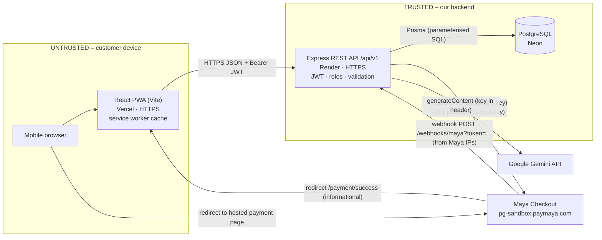
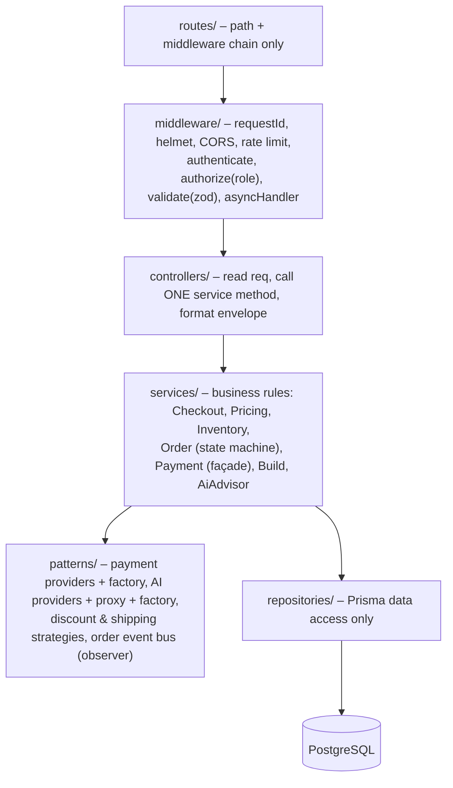
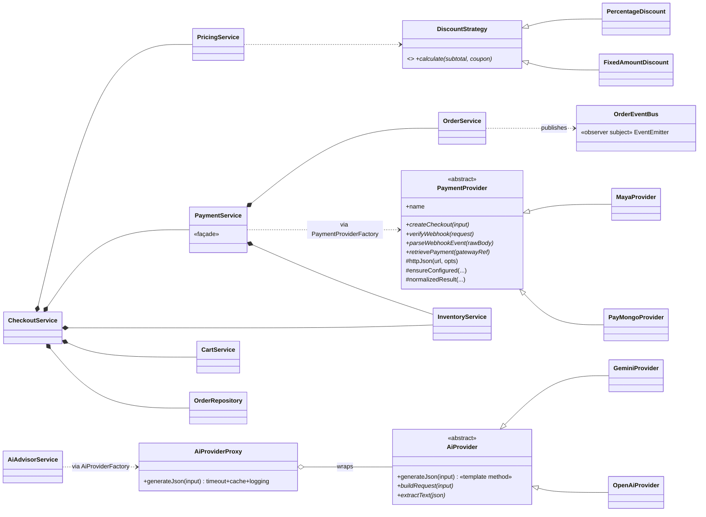

# System Architecture (D-04, T-21, T-22, T-23)

## 1. Context / deployment diagram



- Everything left of the API is **untrusted**: the browser never sees the Maya secret key, the Gemini key or the JWT secret, and nothing it sends about prices or status is trusted.
- The webhook arrow points **into** the API. The success redirect only changes what the customer sees; the order status changes only after the API verifies with Maya.

## 2. Layered (MVC) structure of the API



**Request trace example – `POST /api/v1/orders` (checkout):**
1. `routes/index.js` → `authenticate` → `validate({ body: checkout })`
2. `controllers/orderController.checkout` → validates `Idempotency-Key`, calls `checkoutService.checkout()`
3. `services/checkoutService.js` → `cartService.loadLines` → `compatibilityService.evaluate` → `prisma.$transaction(...)`:
   `pricingService.quote` (DB prices, coupon via `discountStrategyFor`, shipping via `shippingStrategyFor`) → `orderRepository.create` → `couponRepository.incrementUsageIfAvailable` → `inventoryService.reserve` (`productRepository.decrementStockIfAvailable`) → `cartRepository.clear`
4. After commit: `orderEvents.publishAll(order.created)` → `paymentService.createSession` → `createPaymentProvider()` (factory) → `MayaProvider.createCheckout`
5. Controller returns `201 { success, data: { order, checkoutUrl } }`

## 3. Checkout + payment sequence (incl. missed webhook)

```mermaid
sequenceDiagram
  autonumber
  actor U as Customer (PWA)
  participant API as Express API
  participant DB as PostgreSQL
  participant MY as Maya Checkout

  U->>API: POST /orders (shipping, coupon) + Idempotency-Key
  API->>DB: BEGIN; price from DB; insert Order(pending_payment) + items + history;<br/>coupon usage++ (conditional); UPDATE stock WHERE stock>=qty; insert reservations; clear cart; COMMIT
  API->>MY: POST /checkout/v1/checkouts (server total, requestReferenceNumber)
  MY-->>API: { checkoutId, redirectUrl }
  API->>DB: insert Payment(gatewayRef=checkoutId, amount, currency)
  API-->>U: 201 { order, checkoutUrl }
  U->>MY: redirect → pays with sandbox card / wallet
  par Webhook path
    MY->>API: POST /webhooks/maya?token=… { id, status: PAYMENT_SUCCESS }
    API->>API: verify token (constant-time) + source IP
    API->>DB: INSERT WebhookEvent (provider,eventId) UNIQUE → duplicate? ack & stop
    API->>MY: GET /payments/v1/payments/{id} (secret key)
    MY-->>API: { status, amount, currency }
    API->>DB: BEGIN; amount & currency == order? → commit reservations, order→paid, history; COMMIT
    API-->>MY: 200
  and Customer return path
    MY-->>U: redirect /payment/success?orderId=…
    U->>API: POST /orders/:id/verify-payment
    API->>MY: GET payment (same verification as above)
    API-->>U: authoritative order status (polls a few times if still pending)
  end

  Note over API,MY: MISSED WEBHOOK: if the webhook never arrives, the return-page call,<br/>the admin "Reconcile with Maya" button (POST /admin/orders/:id/reconcile),<br/>or the 60-second sweep (checks Maya BEFORE expiring an order) applies the same verification.
  Note over API,DB: FAILED / CANCELLED / EXPIRED: payment row updated, reservations released (stock back),<br/>order stays pending_payment → customer can POST /orders/:id/payment-session (new session).<br/>Hold expires after 30 min → order expired, coupon use returned.
```

## 4. Class / module model (T-23)



Inheritance is used only for the **provider hierarchies** (true "is-a", shared HTTP/verification plumbing, one level deep). Everything else uses **composition** via constructor injection in `services/index.js`.

## 5. PWA client architecture
- `src/api/client.js` – single fetch wrapper, parses envelopes, attaches JWT, handles 401.
- `context/` – `AuthContext` (token + role), `CartContext` (server cart, optimistic updates, offline cache), `NetworkStatusContext`.
- Workbox: app shell precache; `StaleWhileRevalidate` for `GET /products|/categories`; `CacheFirst` for images; no caching of auth, cart, orders, checkout, webhooks, admin or AI.
